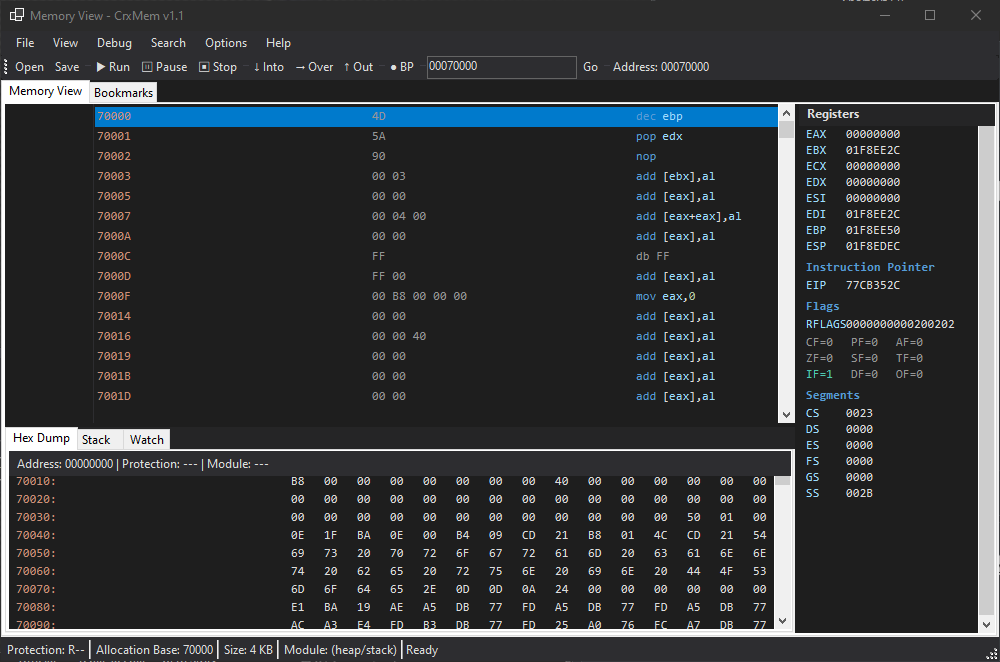

# CrxMem

**Created by ZxPwd**

**Discord: zxpwd**

CrxMem is a Windows memory scanner and analysis project inspired by Cheat Engine. The repository now contains the redesigned compact WPF main application, a newer WPF Memory View, the retained Legacy Memory Viewer, Auto Assembler work, bookmark tooling, Watchdog Hunter research tooling, and optional kernel-driver experiments.

> [!WARNING]
> CrxMem is pre-release research software. User-mode scanning is the most stable path today. Debugger, injection, anti-cheat research, and kernel-driver features remain experimental and can destabilize target processes or Windows.




---

## Project Status

The project has moved well beyond a basic scanner. The current build includes a redesigned main UI, two Memory View routes, bookmark infrastructure, Auto Assembler work, and optional driver-assisted features, but not every advanced debugging feature is fully complete yet.

### Current feature status

| Area | Status | Notes |
|------|--------|-------|
| **Scanner / Address List** | Working, pre-release | Exact/comparison scans, undo, filters, writable-region scanning, and address-list workflows are part of the active WPF shell |
| **Main WPF shell** | Working, pre-release | Compact dark-blue redesign with process status, scan workspace, table workflow, and settings integration |
| **Memory View (WPF)** | Working, pre-release | Disassembly, hex dump, navigation, modules, memory map, patch pane, Auto Assembler entry point, and Bookmark Manager |
| **Memory Viewer (Legacy)** | Working, retained | Previous WinForms/GDI+ viewer remains available as a fallback and comparison route |
| **Bookmarks / comments** | Working, evolving | Docked Bookmark Manager, annotation persistence, edit/move/rebind/import/export paths |
| **Auto Assembler** | Experimental | UI and transactional script infrastructure are present, but compatibility is still incomplete |
| **Debugger / breakpoints** | Prototype | Attach/run-control/stepping work exists, but this is not yet a parity-complete attached debugger |
| **Watchdog Hunter** | Experimental research tool | Thread census and integrity-thread hunting workflows for isolated research use |
| **Lua engine** | Incomplete | Core pieces exist; full compatibility surface is still under development |
| **CrxShield driver path** | Experimental | Optional kernel-assisted operations and tooling, not covered by the managed CI build |

### Important notes

- `Tools > Memory View (WPF)` opens the newer Memory View workspace.
- `Tools > Memory Viewer (Legacy)` opens the retained older viewer.
- The Legacy viewer is still intentionally shipped because it remains useful while newer Memory View features continue to mature.
- Kernel and anti-cheat research features should be treated as isolated-lab functionality, not everyday-safe defaults.

---

## Repository Structure

This repository now includes the main application plus several experimental companion projects and research folders:

```text
CrxMem/
|-- CrxMem/                 # Main C# application (WPF shell + legacy WinForms components)
|-- CrxMem.Tests/           # Managed test suite
|-- CrxShield/              # Experimental kernel driver
|-- CrxShieldClient/        # Driver client/native interop work
|-- VEHDebugDll/            # VEH-based debugging experiments
|-- FxpStrip/               # Native anti-cheat / hook research work
|-- GunzAnalysis/           # Analysis notes, scripts, and research artifacts
`-- Documentation/          # Plans, design references, and implementation notes
```

| Project | Description | Language |
|---------|-------------|----------|
| **CrxMem** | Main GUI application for scanning, editing, analysis, Memory View, and table workflows | C# (.NET 8) |
| **CrxShield** | Experimental Windows kernel driver for kernel-assisted memory access and thread tooling | C / WDK |
| **CrxShieldClient** | Client-side driver access helpers and native interop | C++ / C# |
| **VEHDebugDll** | VEH-based debugging and breakpoint experiments | C++ |
| **FxpStrip** | Native reversing and anti-cheat research project | C++ |
| **GunzAnalysis** | Notes, scripts, and reverse-engineering artifacts | Mixed |

---

## CrxMem Main Application

The main application now uses a dark-themed WPF shell with a compact scanner-first layout while still keeping selected legacy components where they remain useful.

### Main UI highlights

- Compact redesigned main window optimized for smaller screens
- Process-aware header with runtime process status
- Scan Results and Address List in virtualized WPF DataGrids
- Built-in access to Memory View, Legacy Memory Viewer, Lua, PE analysis, Watchdog Hunter, and Settings
- Persistent layout and settings migration support

### Scanner and table features

- Exact, increased, decreased, changed, unchanged, unknown, between, and AOB scan workflows
- Value types including Byte, 2/4/8 Bytes, Float, Double, String, and AOB
- Address-list editing, freezing, save/load, and manual address entry
- Versioned `.crxct` table format with legacy CrxMem `.ct` JSON import support

### Memory analysis features

- **Memory View (WPF)**:
  - disassembly view
  - hex dump
  - stack/watch/breakpoints/call stack/memory map/modules/threads panes
  - patch editor
  - Auto Assembler entry point
  - Bookmark Manager workspace
- **Memory Viewer (Legacy)**:
  - retained WinForms/GDI+ path
  - useful fallback during ongoing WPF debugger and Memory View development

### Research and advanced tooling

- Bookmark/comment annotations with manager workflow
- Auto Assembler editor and preview pipeline
- PE analysis
- Lua integration work
- Watchdog Hunter thread-analysis workflow
- Driver-aware memory operations when CrxShield is connected and enabled

### Tech stack

- .NET 8.0
- WPF and WinForms
- [Iced](https://github.com/icedland/iced) for x86/x64 disassembly
- [NLua](https://github.com/NLua/NLua) for Lua integration work
- [ReaLTaiizor](https://github.com/Developer-Flavor/ReaLTaiizor) for selected UI controls

---

## CrxShield

CrxShield is the repository's experimental kernel-driver track for research builds that need kernel-assisted memory access or thread tooling.

### Current driver-related work

- Kernel-level read/write support
- Process base address retrieval
- Thread enumeration support used by research tooling
- Driver management and restart tooling
- Verification helpers and setup scripts under `CrxShield/Tools`

### Driver warning

Kernel drivers can cause system instability, startup failures, or BSODs. Test only on isolated systems or disposable environments.

---

## VEHDebugDll

`VEHDebugDll` contains vectored-exception-handler debugging experiments used for breakpoint and access-monitor research.

### Includes

- Hardware breakpoint experiments
- Memory access monitoring
- Shared-memory IPC concepts
- Lock-free/event-driven debugging experiments

---

## Building

### Managed solution

```powershell
git clone https://github.com/ZxPwdz/CrxMem.git
cd CrxMem
dotnet restore CrxMem.sln
dotnet build CrxMem.sln -c Release --no-restore
```

Managed output:

```text
CrxMem\bin\Release\net8.0-windows\
```

Authentication is not required to clone the public repository. Contributors should use Git Credential Manager, GitHub CLI browser login, or SSH when pushing. Never place a token in a command, remote URL, script, or committed file.

### CrxShield driver

1. Install the Windows Driver Kit.
2. Open `CrxShield/CrxShield.vcxproj` or the solution in Visual Studio 2022.
3. Build the driver in Release mode.
4. If using test-signed builds, enable testsigning and reboot before loading the driver.

### VEHDebugDll

Build the Visual Studio project in the matching architecture you want to test.

---

## Installation

### Main application

1. Build or download the Release version.
2. Open `CrxMem\bin\Release\net8.0-windows\`.
3. Run `CrxMem.exe`.

### Settings storage

CrxMem stores versioned settings in:

```text
%LocalAppData%\CrxMem\settings.json
```

Older registry-backed settings are imported on first run when appropriate. Invalid JSON is preserved as a timestamped recovery file and replaced with safe defaults.

### Optional driver setup

Driver management helpers live under:

```text
CrxShield\Tools\
```

Use those scripts and commands rather than inventing a custom install flow.

---

## Basic Usage

### Scanner workflow

1. Use `File > Open Process`.
2. Enter a value to search for.
3. Choose a scan type and value type.
4. Run `First Scan`.
5. Change the value in the target.
6. Run `Next Scan` until the result set is small enough.
7. Add matching rows to the Address List.

### Memory View routes

- Use `Memory View` from the main window for the newer WPF route.
- Use `Tools > Memory Viewer (Legacy)` if you want the older retained viewer.

### Bookmark workflow

- In the WPF Memory View, use `Ctrl+D` to toggle a bookmark on the selected instruction.
- Use `;` to edit comment/bookmark metadata.
- Use `Ctrl+Shift+B` or the workspace button to open Bookmark Manager.

---

## Project Details

### CrxMem structure

```text
CrxMem/
|-- Core/                           # Scanning, process access, driver-aware services
|-- MemoryView/                     # Legacy viewer + WPF Memory View implementation
|-- MemoryView/Wpf/                 # Newer Memory View views, services, and themes
|-- Legacy/                         # Retained legacy shell/reference pieces
|-- LuaScripting/                   # Lua integration work
|-- Themes/                         # MainWindow theme resources
|-- MainWindow.xaml                 # Main compact WPF shell
|-- SettingsWindow.xaml             # Settings UI including CrxShield tooling
`-- WatchdogHunterWindow.xaml       # Watchdog Hunter research tool
```

### Documentation

- `Documentation/DesignReferences/` holds captured visual references.
- `Documentation/Plans/` holds milestone and redesign plans.
- Companion folders such as `GunzAnalysis/` and `FxpStrip/` contain deeper research notes and experiments.

---

## Contributing

Contributions are welcome. See [CONTRIBUTING.md](CONTRIBUTING.md) for workflow and boundaries. Report vulnerabilities privately as described in [SECURITY.md](SECURITY.md).

---

## Disclaimer

**This software is provided for educational and security research purposes only.**

- Do not use it for malicious purposes.
- Do not use it to attack online games or third-party services.
- Treat kernel and anti-cheat features as isolated research tooling.
- Always test risky features on systems you can recover.

---

## License

Licensed under the [MIT License](LICENSE).

